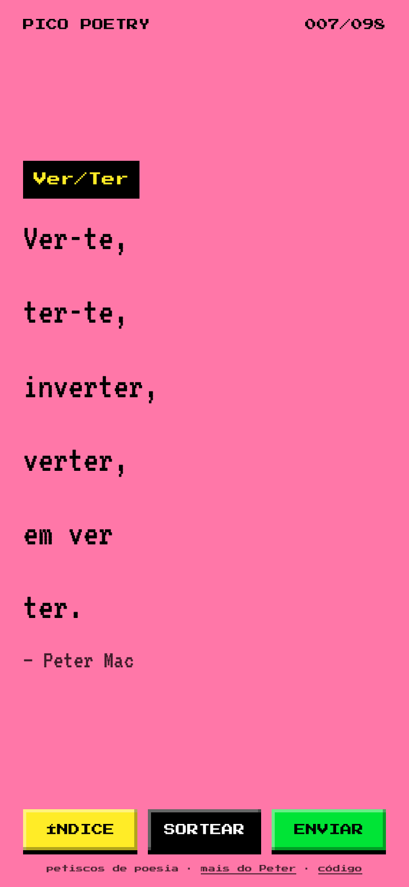
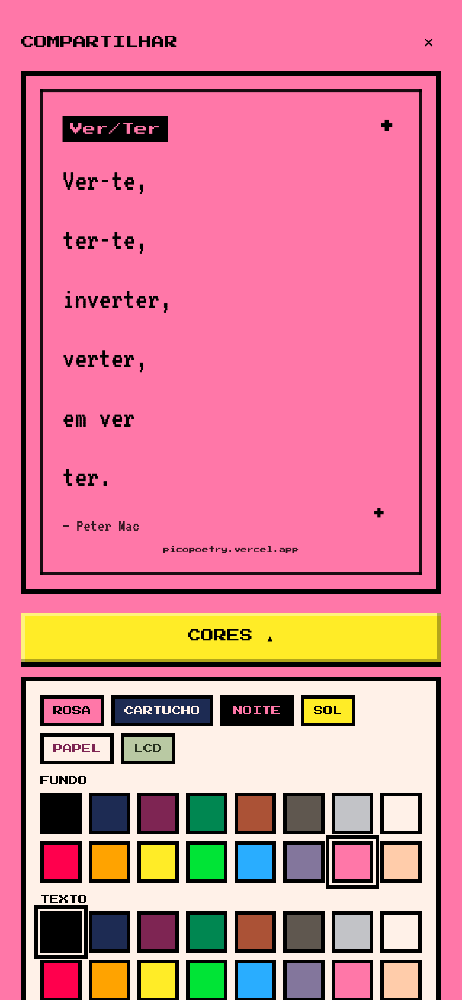
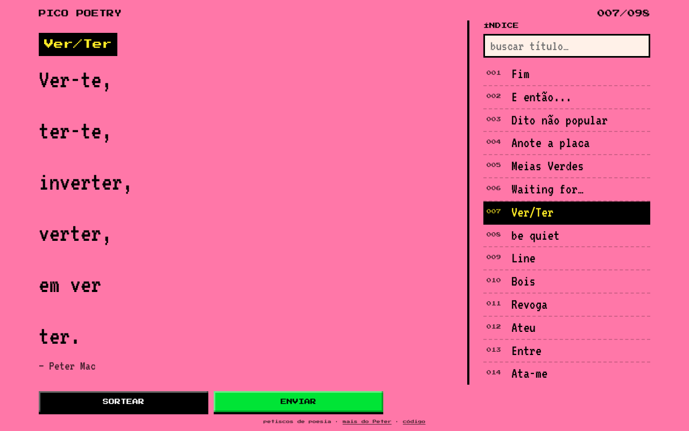
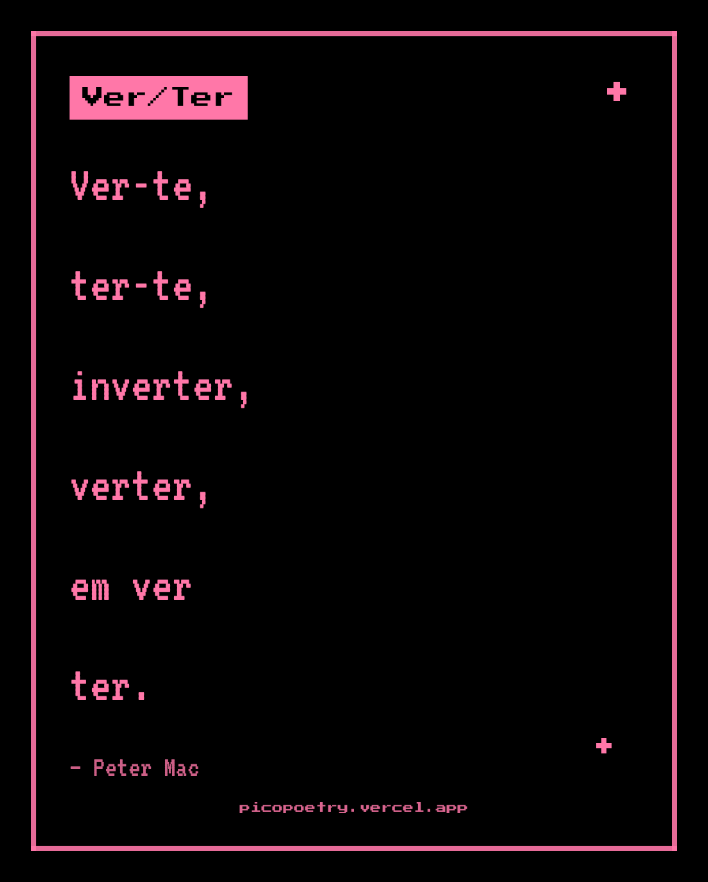

<div align="center">

# 🍬 Pico Poetry

**Petiscos de poesia, em pixel.** 96 poemas do Peter Mac num site em estilo PICO-8: abre numa poesia aleatória, tem índice com busca e vira uma imagem rosa pixelada para compartilhar.

[](https://poesia.javaijafoi.dev)


 &nbsp; 



</div>

## ✨ O que faz

- **Poesia ao abrir:** cada visita começa com uma poesia sorteada.
- **SORTEAR:** nunca repete até passar por todas (espaço, → ou Enter também sorteiam; ← volta).
- **ÍNDICE com busca:** gaveta no celular, coluna fixa no computador.
- **ENVIAR:** gera uma imagem 1080×1350 com a poesia, o nome do site pequeno embaixo e moldura pixelada. No celular abre o compartilhar nativo; no computador baixa o PNG.
- **CORES:** antes de enviar dá para trocar fundo e texto (presets ROSA, CARTUCHO, NOITE, SOL, PAPEL e LCD, ou qualquer cor da paleta PICO-8). O painel esconde de novo e a escolha fica guardada no navegador.
- **Link direto:** `https://poesia.javaijafoi.dev/#7` abre a poesia 7.

<div align="center">

</div>

## 🛠️ Como rodar

Não tem build nem dependências. É HTML, CSS e JavaScript puros.

```bash
git clone https://github.com/javaijafoi/pico-poetry
cd pico-poetry
python3 -m http.server 8765   # ou qualquer servidor estático
# abra http://localhost:8765
```

## 🧩 Como é feito

| Arquivo | Para quê |
| --- | --- |
| `index.html` | estrutura, meta tags, Open Graph e JSON-LD |
| `style.css` | visual PICO-8, tela de celular e de computador (quebra em 900px) |
| `app.js` | sorteio sem repetição, índice, ajuste automático de fonte, desenho do cartão no `<canvas>` e compartilhamento |
| `poems.js` | as 96 poesias |
| `fonts/` | Press Start 2P e VT323, hospedadas aqui mesmo |
| `llms.txt`, `sitemap.xml`, `robots.txt` | para buscadores e assistentes de IA |

Sem backend, sem cadastro e sem rastreamento. A única coisa gravada é a cor escolhida, no `localStorage`.

## 🔗 Do mesmo autor

- 🌴 [Portfólio do Peter](https://javaijafoi.dev): todos os projetos num lugar só
- 🎲 [Rolador](https://github.com/javaijafoi/rolador): dados para qualquer RPG de mesa, também em estilo PICO-8
- 🕹️ [Picotron Arena](https://github.com/javaijafoi/picotron-arcade): modos de arcade num computador de fantasia
- 👤 [@javaijafoi](https://github.com/javaijafoi) no GitHub

## 📄 Licença e direitos

Os textos das poesias são de Peter Mac, todos os direitos reservados. O código pode ser lido e aprendido à vontade.
